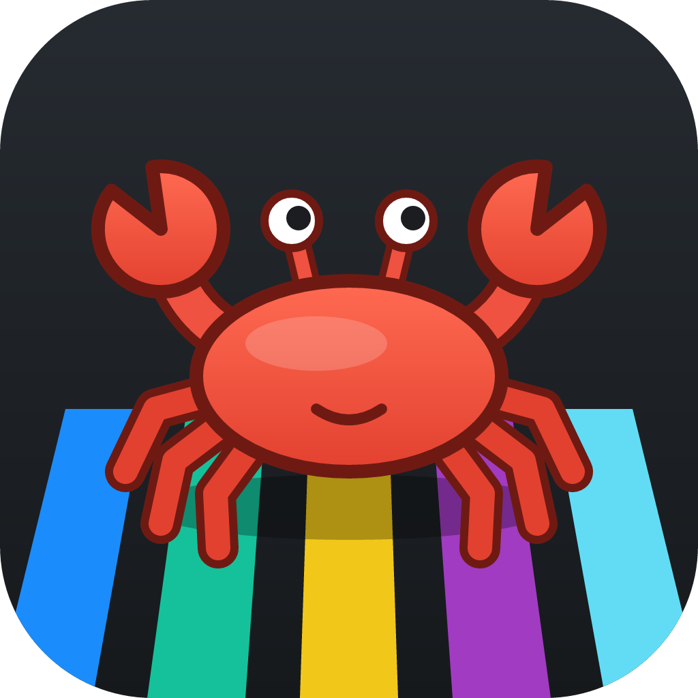
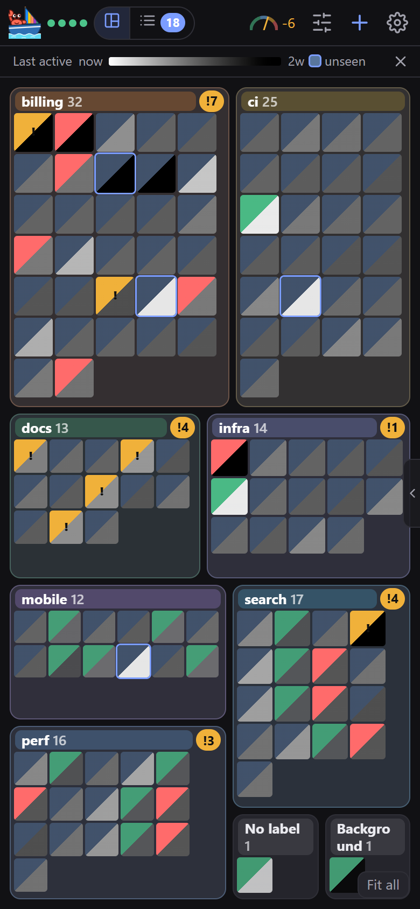
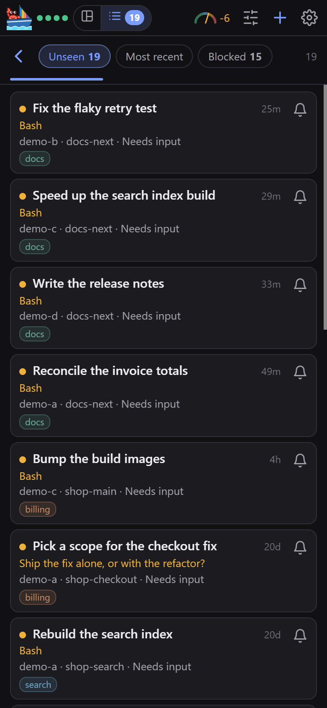
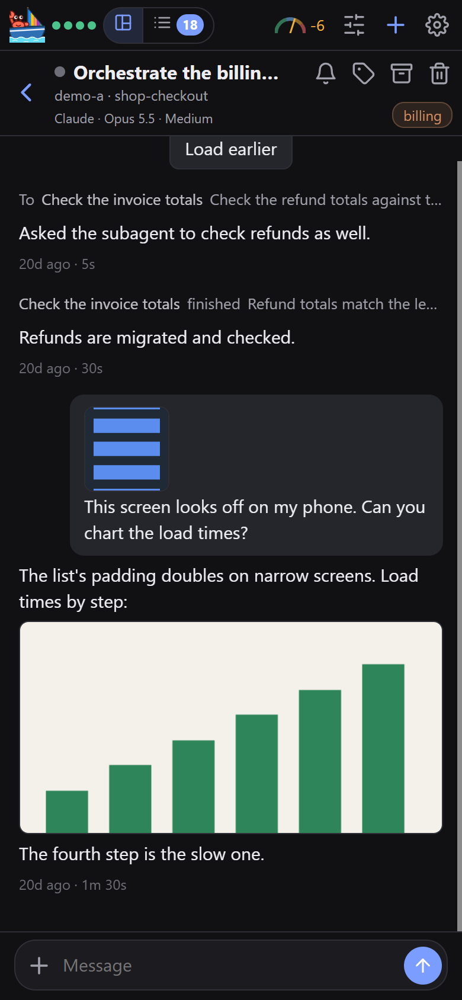
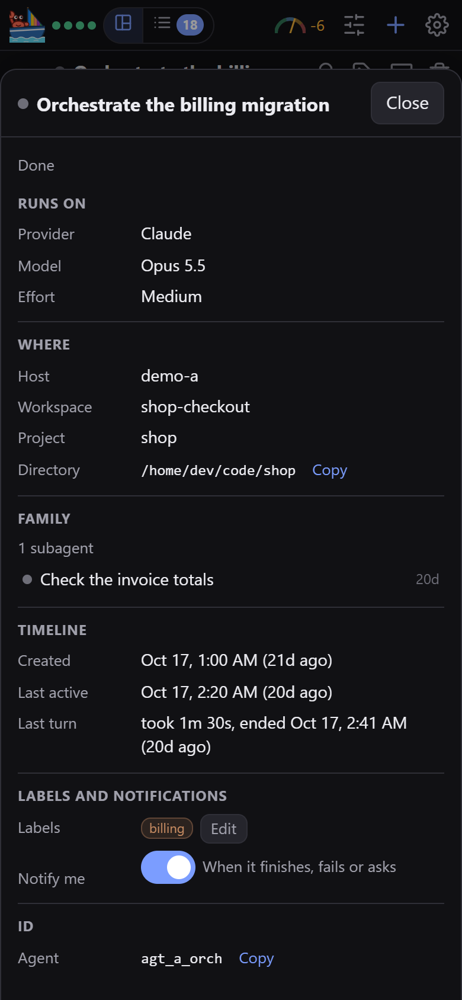
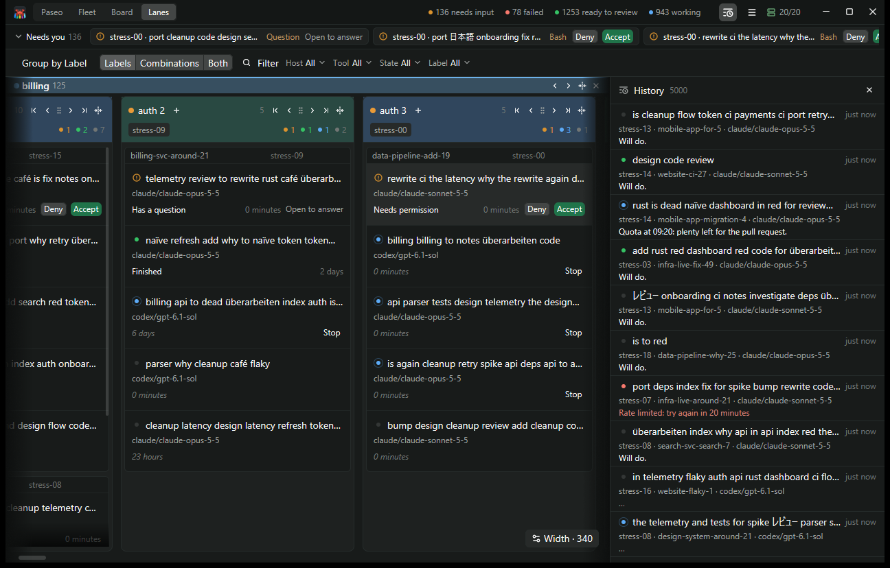
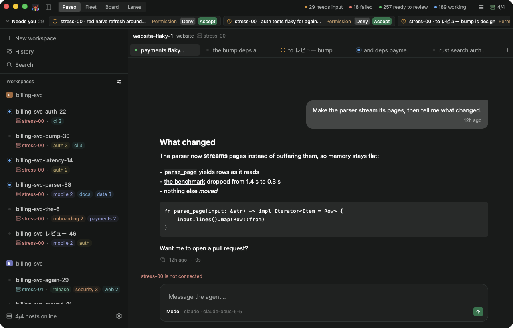
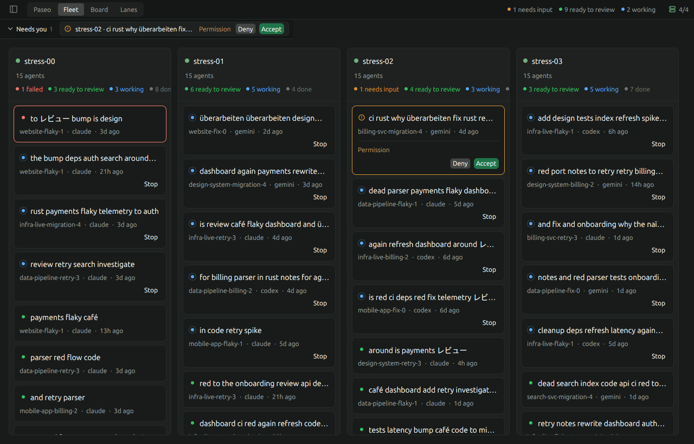
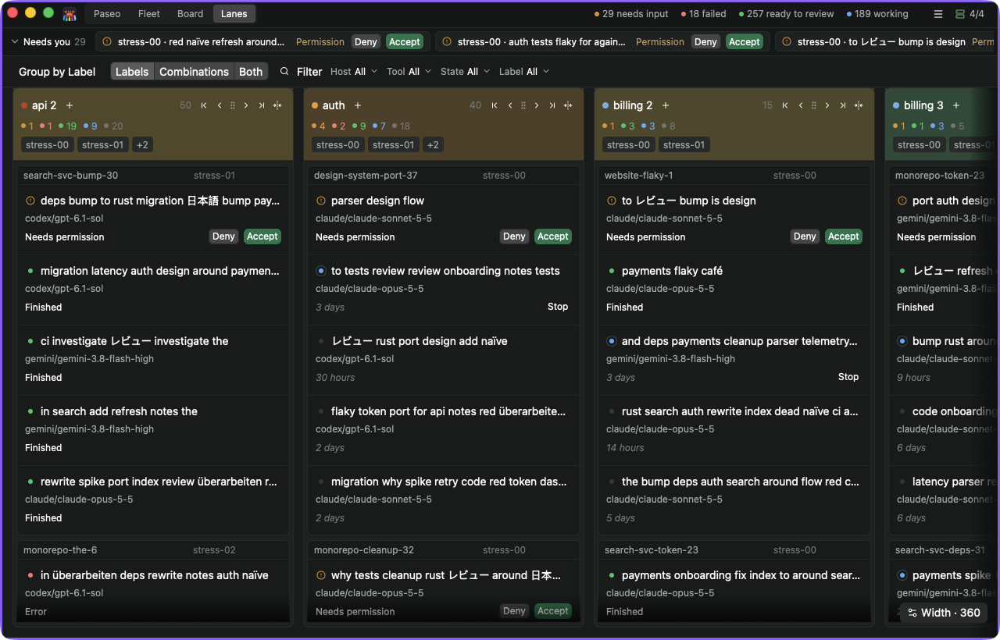
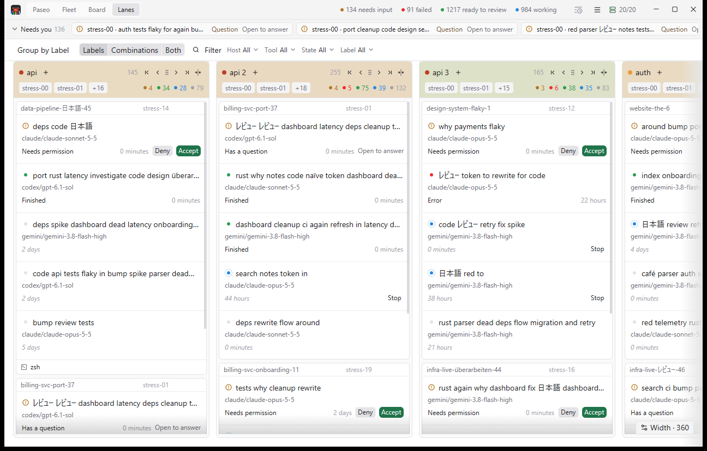

# Crusteo



Run coding agents (Claude Code, Codex, Cursor, OpenCode, Gemini CLI, pi, Antigravity) on all your
machines, and keep an eye on every one of them from your desk or your phone.

Crusteo started as an unofficial native desktop client for [Paseo](https://github.com/getpaseo/paseo)
and grew into three parts that work together, or each on its own alongside Paseo:

- **Burrow**, a daemon for each machine that runs agents: a drop-in replacement for Paseo's daemon,
  written in Rust.
- **Reef** and **Skiff**: Reef keeps up with every daemon on one always-on machine and serves
  Skiff, a small web page for your phone (or any browser) that shows the whole fleet.
- **Crusteo**, a fast native desktop app, written in Rust with [GPUI](https://www.gpui.rs/), that
  connects to every daemon at once.

> **Status: 0.2.0. Early, and moving fast; expect rough edges.** Crusteo is not affiliated
> with or endorsed by the Paseo project. Everything speaks Paseo's daemon protocol (version 1), so
> Paseo's own apps and CLI work with Burrow, and Crusteo and Reef work with Paseo's daemons. See
> [docs/burrow/compatibility.md](docs/burrow/compatibility.md) for exactly which versions were
> checked, and what does not work yet.

## How the parts fit

Each host that runs agents has a daemon, Burrow or Paseo's. The desktop app connects to every one
of them; Skiff connects only to Reef, which connects to every daemon for it.

| Part | Binary | Runs on | Does |
|---|---|---|---|
| **Burrow** | `burrow` | each host that runs agents | Runs your agents with your own installs of each CLI, speaking Paseo's protocol, so any Paseo client connects to it. Runs beside Paseo's daemon, or replaces it and brings its agents over. [Install](docs/burrow/install.md) |
| **Reef** | `reef` | one always-on machine | Connects to every daemon, Burrow or Paseo, and serves **Skiff**. A phone gets one connection carrying only what it shows, not one to each host. Can also record the fleet's activity to files or tools like Elasticsearch. [Install](docs/reef/install.md) |
| **Crusteo** | `crusteo` | your computer | The desktop app: every daemon at once, in one window, with several ways to look at them. On its own it keeps its own host list; in **reef mode** it follows Reef's, so the desktop and Skiff see the same fleet. |

Every release has all three, with the same version, for Linux, macOS and Windows.

**Reef mode.** With a `reef.json` in its data directory naming a Reef (and a device token, unless
Reef runs `--open`), the desktop takes its hosts from Reef and keeps following them: a host added or
removed in Skiff comes and goes on the desktop too. It also takes the fleet's label catalog from
Reef, so labels belong to agents, as in Skiff, and Lanes groups by them. `overrides` give a host
another address or a password for this desktop only. The desktop still connects to each daemon
itself; carrying its conversations through Reef too is planned.

## Screenshots

**Skiff**, on a phone, showing Reef's demo fleet:

| The map | The list | A conversation | An agent's details |
|---|---|---|---|
|  |  |  |  |

**Crusteo**, on the desktop, showing the synthetic `CRUSTEO_STRESS` fleet (20 hosts, 5,000 agents):

| | |
|---|---|
|  | **Lanes**: workspaces as cards in lanes by label, here with a label raised to a band and History docked at the right. |
|  | The **Paseo** layout: sidebar, workspace tabs, live conversation and composer. |
|  | **Fleet**: one column per host, most urgent agents first. |
|  | An optional **window border** (Settings → Window), any width from 1 to 8 px and any colour. |
|  | A **light theme** (Settings → Window → Theme): Light, Dark, or Match system, which follows the system when it switches. |

## Skiff, on your phone

Open Reef's address in a browser, add it to your home screen, and the whole fleet is in your
pocket:

- **The map.** Every agent on every host as a tile, in blocks by label (or host, workspace, state),
  packed to fit the screen. A tile's colour says what it's doing and how long since it last did
  something, and a blue ring says it finished a turn you haven't looked at. Tap a block to see its
  agents up close, and one of them to open it. A label can be raised to a **band** that gathers its
  agents together.
- **The list.** Swipe left, or tap the list icon, for every agent in one list: **Unseen** (what's
  waiting on you, blocked agents first), **Most recent**, or **Blocked**.
- **Unseen means the same everywhere.** It is the daemon's own "ready to review", so opening an
  agent in Skiff marks it seen in Crusteo too, and the other way round.
- **Conversations.** Read and answer: permissions, questions, messages (sent, queued for when the
  turn ends, or steered into it), images, labels, archive. Text can be selected and copied.
- **Agent details.** Tap an agent's name for what it runs on (provider, model, effort, mode,
  context), where, when, and its family: the agent that made it, and the subagents it made.
- **Notifications** when an agent finishes, fails or needs you, per agent or for all; a usage dial
  for your subscriptions; and **+** for a new agent on any host.

## Crusteo, on the desktop

- **Many daemons at once.** Every saved host connects concurrently and reconnects with backoff.
  Switching views never reconnects or loses your place.
- **Layouts.** Paseo, Lanes, Fleet and Board, all reading the same shared state:

  | Layout | What it shows |
  |---|---|
  | **Paseo** | The reference app: sidebar, workspace header, tabs, conversation, composer, plus the New workspace, History (with archived agents) and Hosts screens. |
  | **Lanes** | Workspaces as cards in lanes grouped by label (individual labels, label combinations, or both), project, host or workspace. Expand a card to read and answer its conversation in place, relabel it, or archive it. Labels can be shown as bands. Optional coloured lanes and recency-tinted headers. |
  | **Fleet** | One column per host, every agent on it, most urgent first, with per-host state counts. Answer permission prompts and stop agents right from the cards. |
  | **Board** | Every workspace as a card, in columns by state: Needs input, Failed, Ready to review, Working, Done. |

- **History, docked.** The History button keeps every agent, latest first, at the window's right
  beside whatever layout is up; drag its edge to size it. A click on an agent shows it in the
  layout you're in.
- **Paseo-style navigation.** Sidebar with projects and workspaces merged across hosts, pinning,
  status grouping and filters; per-workspace agent tabs.
- **Add project and New workspace.** Add a folder on any host as a project, searching the host's
  folders as you type. A new workspace opens in the project's folder or in a new git worktree, on a
  branch you name, an existing branch, or one named after the first prompt, starting from a branch
  or a pull request.
- **Live conversations.** Streamed text, tool calls with Paseo's names, summaries and details, task
  lists, and gap-free catch-up after reconnects. Right-click selected text to copy it as shown, or
  as the Markdown the agent wrote; selected text takes the keyboard.
- **Permissions.** Allow or deny tool calls and approve or reject plans inline, or straight from
  Fleet and Lanes cards.
- **Composer.** Send, **steer** a running turn (Enter), **queue** a message for when the turn ends
  (Ctrl/Cmd+Enter), and **interrupt** (Escape). Mode, model and thinking pickers, slash commands,
  and pasted screenshots (up to eight images, 20 MB).
- **Prompt scroll index.** Ticks along the conversation's edge mark each of your prompts; hover to
  preview, click to jump.
- **Built-in terminals** on the daemon's host, next to your agents.
- **Usage gauges.** One pace dial per subscription account in the title bar, from the daemons' own
  usage reports.
- **Command palette** (Ctrl/Cmd+K) over workspaces, agents and actions across every host.
- **Yours to arrange.** Every toolbar can be rearranged, and Lua scripts add items of their own.

## Burrow

`burrow` runs agents on a host and speaks the same protocol as Paseo's daemon, so Crusteo, Reef,
Paseo's apps and Paseo's CLI all connect to it.

- **Providers:** Claude Code, Codex, Cursor, OpenCode, Gemini CLI, pi and Antigravity, with your
  own installs and sign-ins of each. Ones that can't run on a host say why instead of being offered.
- **What Paseo's daemon does:** workspaces and git worktrees, labels, images both ways,
  notifications and push, schedules, and the agent tools that let one agent start, watch and
  message others (for every provider, not only Claude).
- **Beside Paseo or instead of it.** By default it uses its own port (`127.0.0.1:6797`; Paseo uses
  6767) and its own state (`~/.burrow`). To replace Paseo on a host, keeping the host's identity,
  `burrow import-paseo` brings over its projects, workspaces, labels and agents, which carry on their
  sessions; it only ever reads `~/.paseo`. The [install guide](docs/burrow/install.md) covers
  both, upgrades, and going back.
- **Not yet:** terminals for Paseo's apps, diffs, file editing, voice, Paseo's connected hosts and
  relay pairing, and passwords, so keep Burrow on loopback or a locked-down network such as a VPN.

Try it with a placeholder project and agent:

```sh
cargo run -p burrow-daemon --bin burrow -- --seed-demo
```

Then add `127.0.0.1:6797` as a host. [docs/burrow/](docs/burrow/README.md) has the design.

## Reef

`reef` runs on one machine that is always on. It keeps a connection to every daemon in its hosts
file and serves Skiff at its address (port 6798 by default), over a compact protocol of its own:
each phone subscribes to just the views it shows, and Reef sends only what changed. It sends
notifications as turns end, and with `record.json` it records each prompt, reply, tool call and
finished turn to files or to a program such as [Vector](https://vector.dev), resuming where it
left off after an outage. See [docs/reef/install.md](docs/reef/install.md) and
[docs/reef/record.md](docs/reef/record.md).

To look around without a fleet, `reef --demo --open` serves four fake daemons with about ninety
agents.

## Install

### Download a release

Prebuilt binaries for Linux (x86_64; `reef` and `burrow` also arm64), macOS (universal) and
Windows (x86_64) are attached to each [GitHub release](https://github.com/chicagobuss/crusteo/releases).
`SHA256SUMS.txt` covers every archive, and `--version` prints each binary's version and commit.

- **Linux:** unpack the `.tar.gz` and run `./crusteo`. It needs the runtime libraries for
  fontconfig, xkbcommon, Wayland/X11 and Vulkan, which desktop distributions normally have.
- **macOS:** unzip and move `Crusteo.app` to `/Applications`. The app is **not signed or
  notarized**, so Gatekeeper will refuse to open it at first. Either open it once, then choose
  **System Settings → Privacy & Security → Open Anyway**, or clear the quarantine flag:

  ```sh
  xattr -dr com.apple.quarantine /Applications/Crusteo.app
  ```

  The first time Crusteo reaches a daemon on your network, macOS asks to allow **Local Network**
  access; allow it, or connections to hosts on private addresses fail with "No route to host".
  Unsigned builds may be asked again after an update.

- **Windows:** unzip and run `crusteo.exe`. The binary is not code-signed, so SmartScreen may warn
  on first launch; choose **More info → Run anyway**.

`reef` and `burrow` come as their own archives (static binaries on Linux), each with an install
guide and example service files: [docs/reef/install.md](docs/reef/install.md),
[docs/burrow/install.md](docs/burrow/install.md).

### Build from source

You need a recent stable Rust toolchain (edition 2024).

```sh
cargo build --release
./target/release/crusteo
```

On Linux, building needs the usual GPUI system packages (Debian/Ubuntu names):

```sh
sudo apt install libfontconfig-dev libxkbcommon-dev libxkbcommon-x11-dev libwayland-dev \
  libx11-xcb-dev libxcb1-dev libvulkan-dev
```

On macOS the Command Line Tools are enough; shaders are compiled at runtime, so a full Xcode is not
required. On Windows, use the MSVC toolchain with the Windows SDK installed.

## Configuration

### Hosts

Crusteo needs at least one running daemon, Burrow or Paseo's. Hosts are saved in `hosts.json` in
the data directory:

```json
[
  {"name": "local", "endpoint": "localhost:6767"},
  {"name": "buildbox", "endpoint": "buildbox.example:6767", "password": "…"}
]
```

- `name` is a display name; `endpoint` is `host:port`.
- `id` identifies the host; Crusteo adds it when it saves the file, and saved state (tabs, pins,
  filters) follows the id, not the name.
- `password` is optional, for Paseo daemons configured to require one.
- On first launch Crusteo writes a default list containing only `localhost:6767`. After that the file
  in the data directory is the source of truth. Edit it there, or use the **Hosts** screen (sidebar
  footer).
- `CRUSTEO_HOSTS=/path/to/hosts.json` uses a different host list without touching the saved one.
- In [reef mode](#how-the-parts-fit) the list comes from Reef instead (asked for every 30
  seconds), and `reef-hosts.json` keeps the last one, so a start without Reef still has hosts.
  `reef.json` in the data directory turns it on:

  ```json
  {
    "url": "http://reef.example:6798",
    "token": "…",
    "overrides": {"hst_…": {"endpoint": "10.0.0.5:6767"}}
  }
  ```

  `token` is a device token Reef prints when it starts (not needed with `--open`); `overrides`
  give a host, by its id, another address or a password for this desktop only.

A daemon only accepts connections from other machines if it is listening on a reachable address:
Burrow's `--listen`, or Paseo's `listen` and `hostnames` settings.

### Data directory

| Platform | Location |
|---|---|
| Linux | `$XDG_DATA_HOME/crusteo`, or `~/.local/share/crusteo` |
| macOS | `~/Library/Application Support/crusteo` |
| Windows | `%APPDATA%\crusteo` |

Set `CRUSTEO_DATA_DIR` to override it. It holds `hosts.json`, `ui.json` (selection, tabs, sidebar
and layout preferences), `client-id.json` and, optionally, `reef.json` (and `reef-hosts.json`) and
`integrations.json`.

### Extensions

Crusteo can be extended in two ways:

- **Lua toolbar items.** Drop a script in the `toolbars/` folder of the data directory and it adds
  items to any bar, updating on a timer and acting on clicks. See
  [docs/toolbars-lua.md](docs/toolbars-lua.md).
- **Rust extensions**, compiled into a binary of your own that runs Crusteo with them:

  ```rust
  fn main() {
      crusteo::run_with(vec![Box::new(my_extension::Notes)]);
  }
  ```

  An extension implements `crusteo::extensions::Extension`, and every part is optional: toolbar
  items; commands with default keys (in the command palette, the help panel and the macOS menu
  bar); a panel beside the layout; results for find on the Lanes board; buttons in a workspace's
  header; items for the Needs-you strip; numbers for the usage gauges; and settings of its own.
  A toolbar item can add entries to its right-click menu, such as one that opens its settings.
  The module docs in `src/extensions/mod.rs` describe each.

Extensions read their settings from `integrations.json` in the data directory, a flat object of
strings (`crusteo::app::config::integration("key")`), or from environment variables. An
extension with no settings stays off and makes no requests. Settings an extension offers (such
as a service's address) show in Settings under Extensions, where they can be changed or cleared;
crusteo saves them in `integrations.json` and tells the extension.

## Keyboard

`Ctrl` on Linux and Windows, `Cmd` on macOS.

| Keys | Action |
|---|---|
| Ctrl/Cmd+K | Command palette: workspaces, agents and actions across all hosts |
| Ctrl/Cmd+B | Toggle sidebar |
| Ctrl/Cmd+1…9 | Jump to the Nth workspace in the sidebar |
| Ctrl/Cmd+[ / ] | Previous / next workspace |
| Ctrl/Cmd+T | New agent |
| Ctrl/Cmd+Shift+T | New terminal |
| Ctrl/Cmd+W | Close tab (archives the agent, as in Paseo) |
| Ctrl/Cmd+N | New workspace |
| Ctrl/Cmd+L | Focus the composer |
| Ctrl/Cmd+V | Paste text or attach a clipboard image in the composer |
| Ctrl/Cmd+, | Settings, sliding in over the layout |
| Ctrl/Cmd+Shift+H | History, docked at the right; again to hide it |
| Ctrl/Cmd+Shift+L | Cycle layouts |
| Ctrl/Cmd+F | Find on the Lanes board |
| Ctrl/Cmd+= / - / 0 | Zoom in, zoom out, actual size |
| F1, Ctrl/Cmd+/ | Keyboard shortcuts |
| Enter | Send; while the agent works it steers, as Paseo does by default |
| Ctrl/Cmd+Enter | While the agent works, queue the message; it sends when the turn ends |
| Escape | Interrupt the running turn |

The title bar's menu (≡) has Settings, Keyboard shortcuts, Customize toolbars and **About**, which
shows the version, the Paseo protocol and each host's daemon version. Settings and the title bar's
state counts slide a pane in over the layout; closing it leaves the layout as it was. On macOS the
menu bar also has About, Cmd+Q, Cmd+H, Cmd+Option+H and Cmd+M.

In a terminal, copy and paste are Ctrl+Shift+C / Ctrl+Shift+V on Linux and Windows, Cmd+C / Cmd+V
on macOS.

In Skiff, `L` brings the list in and out, Escape goes back, and a sideways two-finger trackpad
swipe works as a phone's swipe does.

## More on Lanes

When grouping by label, the toolbar's **Labels · Combinations · Both** control chooses individual-label lanes, one lane for each complete label set actually in use, or both. Combinations ignore case, spacing, label order and duplicate labels. Paseo's background workspaces are in one Background lane, whatever their labels; **Show background** hides it. The choice is saved on this computer and changes only the view; it does not edit workspace labels.

Any label can be shown as a **band**: right-click a lane's header and choose **Show *label* as band**. Its agents' lanes then sit together under a strip in the label's colour, each lane titled by the agents' other labels, and agents with that label alone in a "just *label*" lane. The band's name and its buttons (move it left or right, collapse it into a tab, stop showing it as a band) stay in view as you scroll along it. Bands are saved on this computer with the lane order and change only the view.

Cards have a consistent height, and lane headers a fixed one with a host row in every lane. Expanded cards have **Relabel** with searchable label choices and a new-label field; unsent composer text and images stay in memory while the app is open. Collapsed lanes appear as named tabs above the board; click one to restore its column. **Width** at the bottom-right opens the width slider and **Fit columns**; Cmd/Ctrl+wheel also resizes columns. In Settings, **Colored lanes** lets you pick from 32 swatches per label lane, and **Smart recency headers** tints headers from blue to dark red as their cards age.

Archiving a workspace from Lanes, Fleet or Board asks for confirmation, names the other affected agents, and warns when a worktree with uncommitted changes or unpushed commits will be deleted.

## Architecture

```
crates/paseo-client     WebSocket client for one daemon. No UI.
crates/fleet            Fleet state and reducers. No I/O, no UI; unit-tested.
crates/term             Terminal emulation for the built-in terminals.
crates/usage-source     The quota model and arithmetic behind the usage gauges.
crates/sampler          Optional sampling profiler (Windows x86_64).
crates/reef             Reef, and Skiff, the single-file page it serves (docs/reef/).
crates/burrow-*         Burrow: the daemon, its protocol types, and one crate per kind of provider (docs/burrow/).
src/app                 GPUI glue: FleetStore (connections + sessions), Nav (where the user is), config.
src/layouts             Views over the shared state, one per layout.
src/extensions          The extension points, and the built-in extensions: Needs you, usage meters, Lua.
src/shell.rs            Window, title bar, layout switcher, command palette, docked History, shortcuts, toasts.
packaging/              Example service files for Reef and Burrow, shipped in their archives.
vendor/gpui-pre         GPUI with Crusteo's rendering fixes; see vendor/gpui-pre/PATCHES.md.
docs/protocol           Wire protocol notes, read from Paseo's source and checked against live daemons.
```

**`paseo-client`** speaks the daemon protocol directly. It does the `hello` handshake with the same
capability set the Paseo app sends, matches requests to replies by `requestId`, decodes `rpc_error`,
sends a heartbeat, and reconnects with backoff. Networking runs on its own tokio runtime; the futures
and event channel it hands back don't depend on any particular runtime.

**`fleet`** is the model. It has no I/O and no UI, so everything in it is tested from captured frames.
- `Directory`: one host's projects, workspaces, agents and labels, kept current from directory-sync
  snapshots and pushes.
- `SidebarView`: Paseo's sidebar computed across hosts. Projects with the same project key merge.
- `timeline`: a port of Paseo's conversation reducer. Streamed and fetched history merge; live events
  are checked against their sequence number and a gap triggers a catch-up fetch; tool-call updates
  merge by call id.
- `display`: Paseo's tool-call names, summaries, icons and expanded-detail rules.

Reef uses the same `paseo-client` and `fleet` without GPUI, so the desktop app, Reef and Burrow's
tests all share one model of a daemon.

### Adding a layout

A layout is a function from the shared `Core` (fleet store + navigation) to a view. Register it in
`src/layouts/mod.rs`:

```rust
LayoutEntry { id: "fleet", title: "Fleet", build: fleet::build }
```

A new view only needs to read the fleet model, so most of the work for a new visualization is in
`crates/fleet`, where it can be tested without a window.

## Development

```sh
cargo test --workspace
cargo clippy --workspace -- -D warnings
cargo fmt --check
```

- `CRUSTEO_STRESS=1` replaces the real hosts with a synthetic fleet far larger and busier than any
  real one (by default 20 hosts, 5,000 agents). Knobs override the defaults, e.g.
  `CRUSTEO_STRESS=hosts:5,workspaces:20,agents:3,churn:50`; see `src/app/stress.rs`. No daemon is
  contacted.
- `reef --demo --open --port 6899 --data-dir <tmp>` tries Skiff against four fake daemons.
- `CRUSTEO_PROFILE=out.folded` (Windows x86_64) samples the UI thread into folded stacks for flame
  graphs.
- Status visuals must settle between updates: Clippy disallows `with_animation` in the app; see
  `src/ui.rs`.

## Not done yet

- A light theme for the desktop app (coming next; Skiff already follows your system's).
- In the desktop app: the file explorer, diffs, split panes, the browser panel, a screen for
  schedules, drag-to-reorder in the sidebar, project icons.
- In Burrow: what's listed [above](#burrow).

## License

Apache License 2.0; see [LICENSE](LICENSE). Portions are derived from Paseo and GPUI; see
[NOTICE](NOTICE) for attributions.
