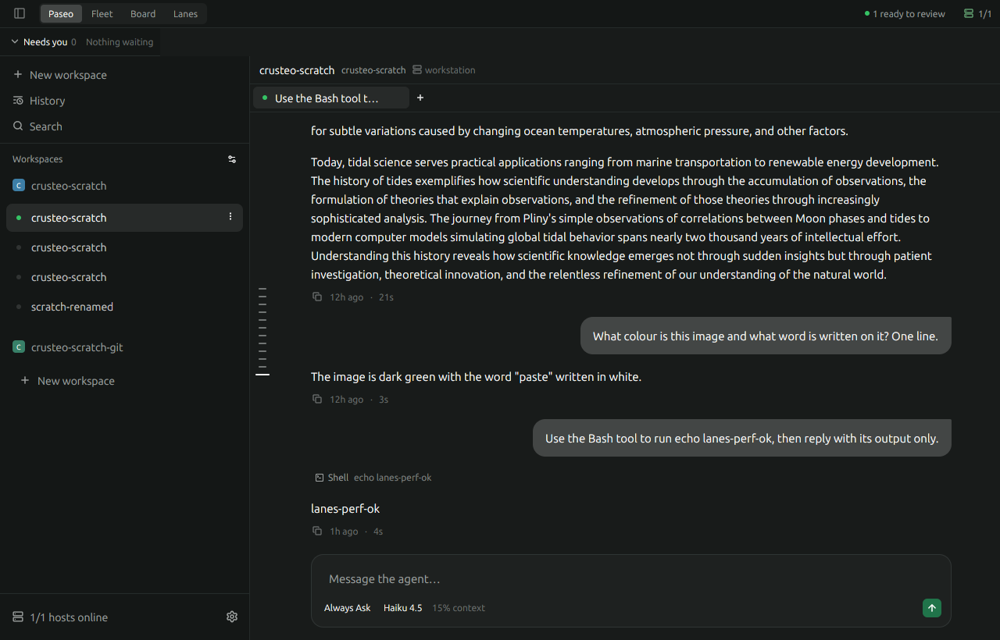
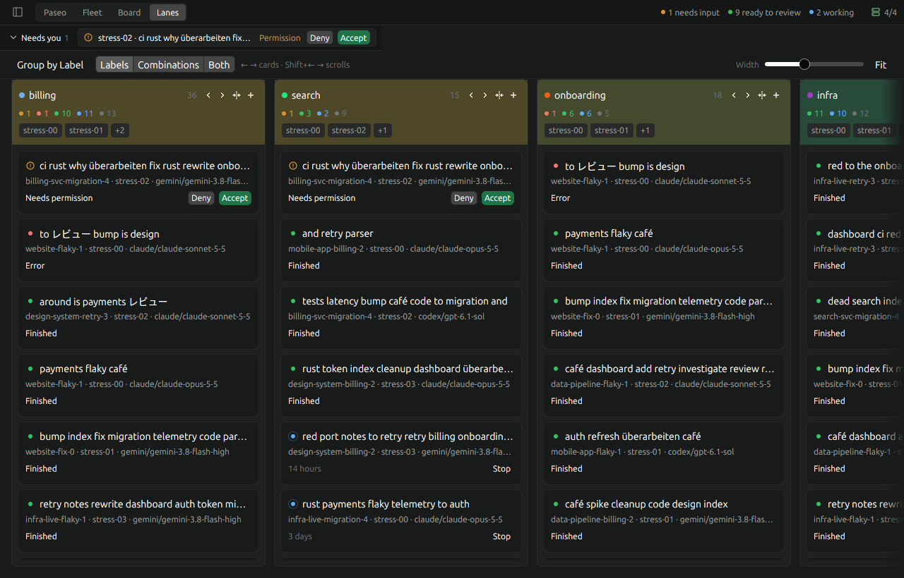
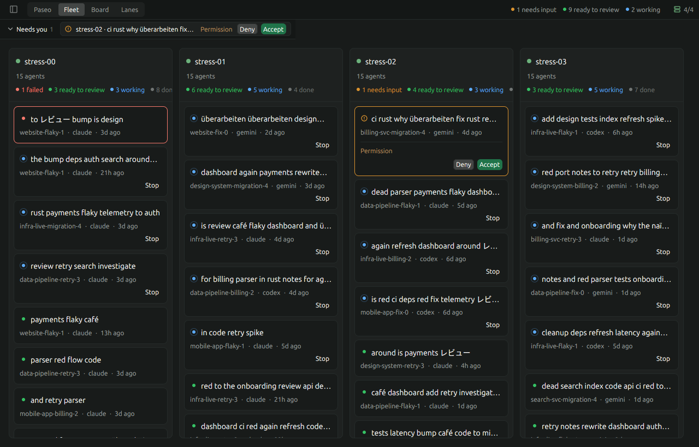

# Crusteo


An unofficial native desktop client for [Paseo](https://github.com/getpaseo/paseo) daemons, written in
Rust with [GPUI](https://www.gpui.rs/). Paseo runs coding agents (Claude Code, Codex and others) on
your machines; Crusteo is a fast, native window onto them.

It does what the Paseo app does: sidebar, workspaces, agent conversations, composer, permissions. It
also connects to **many daemons at once**, merges them into one sidebar, and offers other views of
the same data (Lanes, Fleet, Board) for keeping an eye on lots of agents across lots of hosts.

> **Status: 0.1.0 — early, expect rough edges.** Crusteo is not affiliated with or endorsed by the
> Paseo project. It speaks Paseo's daemon protocol version 1, and is tested against daemons from
> Paseo 0.10.1 through 0.11.2.

## Screenshots

| | |
|---|---|
|  | The **Paseo** layout: sidebar, workspace tabs, live conversation and composer. |
|  | **Lanes**: workspaces as cards in lanes, grouped by label, project, host or workspace. |
|  | **Fleet**: one column per host, most urgent agents first. |

Lanes and Fleet show the synthetic `CRUSTEO_STRESS` fleet.

## Features

- **Paseo-style navigation.** Sidebar with projects and workspaces merged across hosts, pinning,
  status grouping and filters; per-workspace agent tabs; New workspace, History, Hosts and Settings
  screens.
- **Many daemons at once.** Every saved host connects concurrently and reconnects with backoff.
  Switching views never reconnects or loses your place.
- **Live conversations.** Streamed assistant text, tool-call rows with Paseo's names, summaries,
  icons and expandable details, task lists from TodoWrite, and gap-free catch-up after reconnects.
- **Permissions.** Allow or deny tool calls and approve or reject plans inline, or straight from
  Fleet and Lanes cards.
- **Composer.** Send, **steer** a running turn (Enter), **queue** a message for when the turn ends
  (Ctrl/Cmd+Enter), and **interrupt** (Escape). Mode, model and thinking pickers.
- **Slash commands** with completion in the composer.
- **Clipboard images.** Paste screenshots into the composer; they are sent with the prompt (up to
  eight images, 20 MB total), including when steering or queueing.
- **Prompt scroll index.** Ticks along the conversation's edge mark each of your prompts; hover to
  preview, click to jump, loading older history as needed.
- **Built-in terminals.** Open a terminal on the daemon's host next to your agents.
- **Layouts.** Paseo, Lanes, Fleet and Board, all reading the same shared state.
- **Command palette** (Ctrl/Cmd+K) over workspaces, agents and actions across every host.

## Install

### Download a release

Prebuilt binaries for Linux (x86_64), macOS (Apple Silicon and Intel) and Windows (x86_64) are
attached to each [GitHub release](https://github.com/chicagobuss/crusteo/releases).

- **Linux:** unpack the `.tar.gz` and run `./crusteo`. It needs the runtime libraries for
  fontconfig, xkbcommon, Wayland/X11 and Vulkan, which desktop distributions normally have.
- **macOS:** unzip and move `Crusteo.app` to `/Applications`. The app is **not signed or
  notarized**, so Gatekeeper will refuse to open it at first. Either open it once, then choose
  **System Settings → Privacy & Security → Open Anyway**, or clear the quarantine flag:

  ```sh
  xattr -dr com.apple.quarantine /Applications/Crusteo.app
  ```

  The first time Crusteo reaches a daemon on your network, macOS asks to allow **Local Network**
  access; allow it, or connections to hosts on private addresses fail with "No route to host".
  Unsigned builds may be asked again after an update.

- **Windows:** unzip and run `crusteo.exe`. The binary is not code-signed, so SmartScreen may warn
  on first launch; choose **More info → Run anyway**.

### Build from source

You need a recent stable Rust toolchain (edition 2024).

```sh
cargo build --release
./target/release/crusteo
```

On Linux, building needs the usual GPUI system packages (Debian/Ubuntu names):

```sh
sudo apt install libfontconfig-dev libxkbcommon-dev libxkbcommon-x11-dev libwayland-dev \
  libx11-xcb-dev libxcb1-dev libvulkan-dev
```

On macOS the Command Line Tools are enough; shaders are compiled at runtime, so a full Xcode is not
required. On Windows, use the MSVC toolchain with the Windows SDK installed.

## Configuration

### Hosts

Crusteo needs at least one running Paseo daemon (by default it listens on port 6767). Hosts are
saved in `hosts.json` in the data directory:

```json
[
  {"name": "local", "endpoint": "localhost:6767"},
  {"name": "buildbox", "endpoint": "buildbox.example:6767", "password": "…"}
]
```

- `name` is a display name; `endpoint` is `host:port`.
- `password` is optional, for daemons configured to require one.
- On first launch Crusteo writes a default list containing only `localhost:6767`. After that the file
  in the data directory is the source of truth. Edit it there, or use the **Hosts** screen (sidebar
  footer).
- `CRUSTEO_HOSTS=/path/to/hosts.json` uses a different host list without touching the saved one,
  which is handy for pointing at a throwaway daemon.

A daemon only accepts connections from other machines if it is listening on a reachable address;
see Paseo's documentation for its `listen` and `hostnames` settings.

### Data directory

| Platform | Location |
|---|---|
| Linux | `$XDG_DATA_HOME/crusteo`, or `~/.local/share/crusteo` |
| macOS | `~/Library/Application Support/crusteo` |
| Windows | `%APPDATA%\crusteo` |

Set `CRUSTEO_DATA_DIR` to override it. It holds `hosts.json`, `ui.json` (selection, tabs, sidebar
and layout preferences), `client-id.json` and, optionally, `integrations.json`.

### Extensions

Crusteo can be extended in two ways:

- **Lua toolbar items.** Drop a script in the `toolbars/` folder of the data directory and it adds
  items to any bar, updating on a timer and acting on clicks. See
  [docs/toolbars-lua.md](docs/toolbars-lua.md).
- **Rust extensions**, compiled into a binary of your own that runs Crusteo with them:

  ```rust
  fn main() {
      crusteo::run_with(vec![Box::new(my_extension::Notes)]);
  }
  ```

  An extension implements `crusteo::extensions::Extension`. When the window opens it says what it
  adds, and every part is optional: toolbar items; commands with default keys, which appear in
  the command palette, the help panel and the macOS menu bar; a panel beside the layout; results
  for find on the Lanes board, and an answer when Enter is pressed with none chosen; buttons in a
  workspace's header; items for the Needs-you strip; and numbers for the usage gauges. The
  module docs in `src/extensions/mod.rs` describe each.

Extensions read their settings from `integrations.json` in the data directory, a flat object of
strings (`crusteo::app::config::integration("key")`), or from environment variables. An
extension with no settings stays off and makes no requests.

## Keyboard

`Ctrl` on Linux and Windows, `Cmd` on macOS.

| Keys | Action |
|---|---|
| Ctrl/Cmd+K | Command palette: workspaces, agents and actions across all hosts |
| Ctrl/Cmd+B | Toggle sidebar |
| Ctrl/Cmd+1…9 | Jump to the Nth workspace in the sidebar |
| Ctrl/Cmd+[ / ] | Previous / next workspace |
| Ctrl/Cmd+T | New agent tab |
| Ctrl/Cmd+Shift+T | New terminal |
| Ctrl/Cmd+W | Close tab (archives the agent, as in Paseo) |
| Ctrl/Cmd+N | New workspace |
| Ctrl/Cmd+L | Focus the composer |
| Ctrl/Cmd+V | Paste text or attach a clipboard image in the composer |
| Ctrl/Cmd+, | Settings |
| Ctrl/Cmd+Shift+L | Cycle layouts |
| Ctrl/Cmd+F | Find on the Lanes board |
| Ctrl/Cmd+= / - / 0 | Zoom in, zoom out, actual size |
| F1, Ctrl/Cmd+/ | Keyboard shortcuts |
| Enter | Send; while the agent works it steers, as Paseo does by default |
| Ctrl/Cmd+Enter | While the agent works, queue the message; it sends when the turn ends |
| Escape | Interrupt the running turn |

On macOS the menu bar also has Cmd+Q, Cmd+H, Cmd+Option+H and Cmd+M, and **Crusteo → About Crusteo**
shows the version, the Paseo protocol and each host's daemon version.

In a terminal, copy and paste are Ctrl+Shift+C / Ctrl+Shift+V on Linux and Windows, Cmd+C / Cmd+V
on macOS.

## Layouts

| Layout | What it shows |
|---|---|
| **Paseo** | The reference app: sidebar, workspace header, tabs, conversation, composer, plus the New workspace, History, Hosts and Settings screens. |
| **Lanes** | Workspaces as cards in lanes grouped by label (individual labels, label combinations, or both), project, host or workspace. Expand a card to read and answer its conversation in place, relabel it, or archive it. Optional colored lanes and recency-tinted headers. |
| **Fleet** | One column per host, every agent on it, most urgent first, with per-host state counts. Answer permission prompts and stop agents right from the cards. |
| **Board** | Every workspace as a card, in columns by state: Needs input, Failed, Ready to review, Working, Done. |

Archiving a workspace from Lanes, Fleet or Board asks for confirmation, names the other affected
agents, and warns when a worktree with uncommitted changes or unpushed commits will be deleted.

Close an agent tab from an expanded Lanes card's **Close agent tab** button, or by right-clicking a
Lanes or Fleet card. This archives the agent; running agents ask for confirmation. Closing the last
agent in a workspace offers to archive the whole workspace instead. Workspace menus, including
Board cards, also offer **Archive workspace…**. That confirmation names the other affected agents
and warns when a worktree will be deleted, including known uncommitted changes and unpushed commits.
Cancel leaves it intact. Lane headers can move a lane one position left or right, or to either end.

## Architecture

```
crates/paseo-client   WebSocket client for one daemon. No UI.
crates/fleet          Fleet state and reducers. No I/O, no UI; unit-tested.
crates/term           Terminal emulation for the built-in terminals.
crates/sampler        Optional sampling profiler (Windows x86_64).
crates/usage-source   The quota model and arithmetic behind the usage gauges.
src/extensions        The extension points, and the built-in extensions: Needs you, usage meters, Lua.
src/app               GPUI glue: FleetStore (connections + sessions), Nav (where the user is), config.
src/layouts           Views over the shared state, one per layout.
src/shell.rs          Window, title bar, layout switcher, command palette, shortcuts, toasts.
vendor/gpui-pre       GPUI with Crusteo's rendering fixes; see vendor/gpui-pre/PATCHES.md.
docs/protocol         Wire protocol notes, read from Paseo v0.10.1, checked against live daemons, and
                      diffed against v0.11.2 (see transport.md, version notes).
```

**`paseo-client`** speaks the daemon protocol directly. It does the `hello` handshake with the same
capability set the Paseo app sends, matches requests to replies by `requestId`, decodes `rpc_error`,
sends a heartbeat, and reconnects with backoff. Networking runs on its own tokio runtime; the futures
and event channel it hands back don't depend on any particular runtime.

**`fleet`** is the model. It has no I/O and no UI, so everything in it is tested from captured frames.
- `Directory`: one host's projects, workspaces, agents and labels, kept current from directory-sync
  snapshots and pushes.
- `SidebarView`: Paseo's sidebar computed across hosts. Projects with the same project key merge.
- `timeline`: a port of Paseo's conversation reducer. Streamed and fetched history merge; live events
  are checked against their sequence number and a gap triggers a catch-up fetch; tool-call updates
  merge by call id. `tests/replay.rs` replays a captured session and checks the live stream reduces
  to exactly the rows the daemon serves for that history.
- `display`: Paseo's tool-call names, summaries, icons and expanded-detail rules.

**`FleetStore`** (`src/app/store.rs`) owns one `paseo_client::Client` per saved host, subscribes to
the directory and session events, resumes from the saved sync cursor after a reconnect, and routes
every write (send, steer, queue, interrupt, permissions, create, archive, rename, labels).

**`Nav`** (`src/app/nav.rs`) tracks where the user is. Tabs are client-local, as in Paseo, and are
reconciled against the directory: every live root agent gets a tab unless you closed it.

### Adding a layout

A layout is a function from the shared `Core` (fleet store + navigation) to a view. Register it in
`src/layouts/mod.rs`:

```rust
LayoutEntry { id: "fleet", title: "Fleet", build: fleet::build }
```

A new view only needs to read the fleet model, so most of the work for a new visualization is in
`crates/fleet`, where it can be tested without a window.

## Conversation navigation and images

The conversation's left edge has a prompt index. Hover a tick for a preview and click to jump to that user message. Supported daemons supply the complete prompt list; jumps load earlier history as needed without replacing the live tail. Older daemons use the loaded conversation's prompts. The current prompt is highlighted as you scroll.

Paste screenshots or copied images directly into the message box with Cmd+V on macOS or Ctrl+V elsewhere. A thumbnail appears above the text; its × removes it before sending. Images work in new-agent drafts, ordinary sends, steering, and queued messages, including image-only prompts. Clipboard image formats are converted to PNG. Up to eight images totaling 20 MB can be attached. A rejected send offers **Restore failed message** with its images intact.

## Lanes preferences

When grouping by label, the toolbar’s **Labels · Combinations · Both** control chooses individual-label lanes, one lane for each complete label set actually in use, or both. Combinations ignore case, spacing, label order and duplicate labels. They do not generate unused subsets. Single-label sets and Unlabelled appear once in Both mode. Combination headers have a stacked icon. The choice is saved on this computer and changes only the view; it does not edit workspace labels. Expanded conversations, focused cards and drafts follow their valid lane when the mode changes.

Normal cards have a consistent height. Lane headers also have a fixed height with a host row in every lane, including single-host lanes; long host names truncate, with full names on hover; larger lists use a “+N” chip instead of wrapping. When a card has no status text, its footer shows a subdued italic activity age: minutes before two hours, hours before two days, and days thereafter. Expanded cards have **Relabel** with searchable, scrollable label choices and a new-label field. Labels apply to the whole workspace. **Apply** commits the selection; **Cancel** discards it. Settings controls whether the expanded conversation follows its destination after relabeling. Unsent composer text and images stay in memory while the app remains open.

Fades mark the board edges where more lanes remain. Hover an edge or the bottom track to reveal the horizontal scrollbar; it also remains visible during scrolling and dragging. Collapsed lanes appear as named tabs with a color dot and card count in the toolbar above the board. The tab row scrolls horizontally when needed; click a tab to restore its column in its saved order and reveal it. Hidden lanes take no board width, and card navigation and Fit consider displayed columns. Drafts, expanded conversations and card scroll positions stay available when a lane is restored. **Width** at the bottom-right opens the width slider and **Fit columns**; Cmd/Ctrl+wheel also resizes columns.

Open Settings with Cmd/Ctrl+, to enable **Colored lanes**, then group by label and click a lane’s color dot to choose from 32 swatches. These are saved display choices on this computer; they do not change Paseo’s shared label colors. Column and card surfaces use a subdued tint of that hue. **Smart recency headers** independently uses a blue → green → yellow → dark red ramp. Latest activity sets the baseline, while aging permission/error cards warm busy lanes, with greater weight when more cards are blocked. Finished-turn notifications have less influence. Activity ages use the daemon’s last-update timestamp.

## Platforms

- **Linux:** X11 and Wayland via GPUI. Developed and tested on Ubuntu.
- **macOS:** Apple Silicon and Intel. Builds with just the Command Line Tools.
- **Windows:** x86_64, MSVC toolchain.

## Development

```sh
cargo test --workspace
cargo clippy --workspace -- -D warnings
cargo fmt --check
```

- `CRUSTEO_STRESS=1` replaces the real hosts with a synthetic fleet far larger and busier than any
  real one (by default 20 hosts, 5,000 agents). Knobs override the defaults, e.g.
  `CRUSTEO_STRESS=hosts:5,workspaces:20,agents:3,churn:50`; see `src/app/stress.rs`. No daemon is
  contacted.
- `CRUSTEO_PROFILE=out.folded` (Windows x86_64) samples the UI thread into folded stacks for flame
  graphs. `CRUSTEO_PROFILE_DELAY` and `CRUSTEO_PROFILE_SECS` set when sampling starts and how long it
  runs (10 s each by default).
- Status visuals must settle between updates: Clippy disallows `with_animation` in the app; see
  `src/ui.rs`.

## Not done yet

- The file explorer, diffs, split panes, the browser panel.
- Subagent tracks, schedules.
- Drag-to-reorder in the sidebar, project icons, project removal.

## License

Apache License 2.0; see [LICENSE](LICENSE). Portions are derived from Paseo and GPUI; see
[NOTICE](NOTICE) for attributions.
